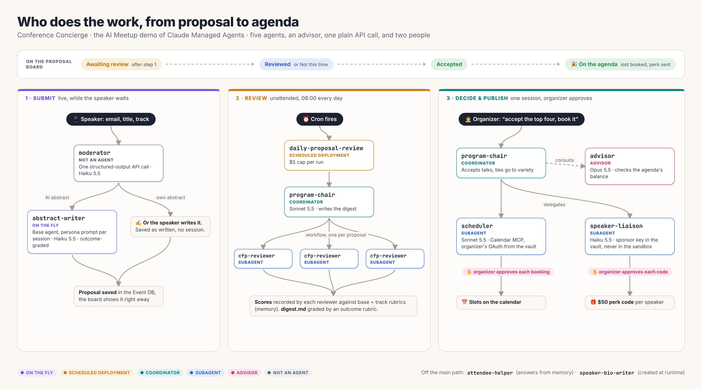

# Conference Concierge

A small, friendly demo of **Claude Managed Agents**. 
I created it for a 15-minute presentation at a Claude user group in San Diego. 

Conference Concierge consists of a team of agents that helps run a
user-group meetup. Members propose talks from their phones, agents review them every
morning, an organizer approves the agenda, speakers get a sponsor perk, and attendees ask
about the venue.

This source is built to be read. Major features have a short [task guide](docs/guides/README.md) that
points to the exact lines that implement it, and the source carries matching markers, like this one: 

```python
# Guide 05 · Wiring up OpenTelemetry · Step 2: register the tracer provider.
```

Search the repo for `Guide 05 ·` to see every step of a guide in place.

Disclaimer: All the code and guides are AI generated. This is a sample that introduces concepts and features; it is not production code or production prompts.  If you see issues, please [report them](https://github.com/jaimerodriguez/conference-concierge/issues) or [create a PR](https://github.com/jaimerodriguez/conference-concierge/pulls).

## How a talk proposal moves through the concierge's workflows



Each step's agent, its type, and the guide that explains it are mapped in
[the guide map](docs/images/guide-map.png). The images are rendered from HTML in
[docs/images/source](docs/images/source/README.md).

## What it shows

| Feature | Where it appears in the story | Guide |
|---|---|---|
| Agents declared as files, applied with the `ant` CLI | The whole agent team | [01](docs/guides/01-declaring-agents-with-ant-cli.md) |
| Agent versions and pinning | The Attendee Helper | [02](docs/guides/02-versioning-and-pinning.md) |
| Agents on the fly | Abstract Writer (session overrides), Bio Writer (created at runtime) | [03](docs/guides/03-agents-on-the-fly.md) |
| System-level memory | Venue profiles, rubrics, and ops notes shared by all sessions | [04](docs/guides/04-system-level-memory.md) |
| OpenTelemetry | One trace from the CLI through the session | [05](docs/guides/05-wiring-up-opentelemetry.md) |
| Vaults | The sponsor's API key, never visible to the agent | [06](docs/guides/06-storing-secrets-in-a-vault.md) |
| MCP with OAuth from the client | Booking on the organizer's calendar | [07](docs/guides/07-oauth-credentials-for-mcp.md) |
| Multi-agent: roster and dynamic workflows | The Program Chair and its specialists | [08](docs/guides/08-multi-agent-orchestrator.md) |
| Multi-agent: advisor | A second opinion on the agenda | [09](docs/guides/09-adding-an-advisor.md) |
| Scheduled agents | The daily proposal review | [10](docs/guides/10-scheduling-an-agent.md) |
| Outcomes | Abstracts and the review digest, graded against rubrics | [11](docs/guides/11-grading-with-outcomes.md) |
| Approvals and budgets | The organizer approves each booking and perk code | [12](docs/guides/12-approvals-and-budgets.md) |
| Input moderation | Titles and abstracts typed by the audience | [13](docs/guides/13-moderating-user-input.md) |
| Self-hosted sandbox (phase 2a) | Tools run in your container | [20](docs/guides/20-self-hosted-sandbox.md) |
| Self-hosted Managed Agents (phase 2b) | You run the service; see what you keep and lose | [21](docs/guides/21-migrating-to-self-hosted-managed-agents.md) |

The full design is in [docs/SPEC.md](docs/SPEC.md).

## Quickstart

### 1. Install the prerequisites

You need Git, [uv](https://docs.astral.sh/uv/) (which also installs Python 3.12 for you),
the `ant` CLI (1.40.0 or later), a tunnel tool (`cloudflared` here; `ngrok` also works),
and a Claude API key from the [Console](https://platform.claude.com). Docker is optional:
it runs Jaeger (Guide 05) and the phase 2a worker (Guide 20).

**macOS** (with [Homebrew](https://brew.sh); open Terminal):

```sh
brew install git uv cloudflared anthropics/tap/ant
brew install --cask docker              # optional
```

**Windows** (open PowerShell 7 or Windows Terminal; PowerShell 5.1 does not support `&&`,
which some commands below use. Install PowerShell 7 with `winget install Microsoft.PowerShell`):

```powershell
winget install Git.Git astral-sh.uv Cloudflare.cloudflared GoLang.Go
winget install Docker.DockerDesktop     # optional
```

Open a new terminal so the new tools are on your `PATH`, then install the `ant` CLI with Go.
Go puts it in `%USERPROFILE%\go\bin`, which you add to your `PATH`:

```powershell
go install github.com/anthropics/anthropic-cli/v2/cmd/ant@latest
$env:Path += ";$env:USERPROFILE\go\bin"    # for this terminal; add it to your user PATH to keep it
```

**Check and sign in** (both systems). Resources are created in the workspace your `ant`
profile or API key belongs to, not the one named in `.env`; see
[Which workspace?](docs/guides/00-setting-up.md#which-workspace).

```sh
git --version && uv --version && cloudflared --version
ant --version                           # must be 1.40.0 or later
ant auth login                          # or: export ANTHROPIC_API_KEY=sk-ant-...
ant auth status                         # confirm the workspace before `ant apply`
```

On Windows, set the key for the current terminal with `$env:ANTHROPIC_API_KEY = "sk-ant-..."`.
Commands below that start with `export` are for macOS and Linux; the Windows form is
`$env:NAME = "value"`.

### 2. Set up and run

[Guide 00](docs/guides/00-setting-up.md) has the details.

```sh
uv sync                                   # virtual environment + dependencies
cp .env.example .env                      # then replace each change-me
uv run pytest                             # tests need no API key

uv run concierge serve                    # terminal 1: mock services and the proposal form
cloudflared tunnel --url http://localhost:8000    # terminal 2: prints your public address
```

**Your tunnel address.** Anthropic's cloud calls the mock services from the internet, so
they need a public HTTPS address, and the tunnel provides it. `cloudflared` prints a line
like this in terminal 2 (with `ngrok http 8000`, look for the `Forwarding` line):

```text
https://random-words-here.trycloudflare.com
```

That is your **tunnel address**; `random-words-here.trycloudflare.com` is your
**tunnel host**. Type it once, in `.env`, as the full `https` address:
`CONCIERGE_PUBLIC_BASE_URL=https://random-words-here.trycloudflare.com` (no trailing slash).
Then stop and restart `concierge serve` in terminal 1. Everything else reads it from there,
so you don't retype it: the next command takes the host from `.env`.

With `serve` and the tunnel running and `.env` set, one command does the rest of the phase 1
setup, in order, and stops at the first problem:

```sh
uv run concierge setup all
```

It writes the host from `.env` into `managed/`, runs `ant apply` from inside `managed/`
(it shows `ant`'s plan and asks first; `--yes` skips the question), seeds the memory stores,
stores the vault secrets, signs you in to the Calendar, gives the daily-review deployment its
vault, applies again, and finishes with `doctor`. The Calendar sign-in **opens a browser tab**
for the organizer login (use `--no-browser` to get a link to open yourself); if the vault
already holds a Calendar token it skips that step (`--reauth-calendar` forces it). Re-running
is safe.

Prefer to do it step by step, as the guides do? These are the same steps:

```sh
## REMINDER: setup all (above) does all of these. We recommend using that command instead. 
uv run concierge setup host                       # no argument: uses the host in .env
cd managed && ant apply agents environments memory_stores vaults && cd ..   # from inside managed/
uv run concierge setup memory                     # seed venues, rubrics, notes
uv run concierge setup vault                      # store the pretend secrets
uv run concierge auth calendar                    # sign in as the organizer
uv run concierge setup deployment                 # put the vault's ID in the daily-review deployment
cd managed && ant apply && cd ..                  # again, from inside managed/: now with the deployment
```

After you have run the setup, confirm your configuration with the doctor command 

```sh
uv run concierge doctor                           # what is missing, and whether every URL agrees
```


The free `cloudflared` address **changes every time you restart the tunnel**. Keep terminal 2
running while you use the demo. If the address changes: update `.env`, restart `serve`, and run
`uv run concierge setup all` again. It rewrites the host, re-applies, stores the vault
credentials for the new address and, because the vault has no Calendar token for that new
address, signs you in again. (Credentials are matched to a server by its exact URL.)
A named tunnel with a fixed hostname (Cloudflare account) or a reserved ngrok domain avoids all
of that.

## The demo, in order

For a clean start, clear the data from earlier runs and add sample proposals first (see
[Demo data](#demo-data) below): `uv run concierge data clear`, then `uv run concierge data sample`.

```sh
uv run concierge propose "Building AI agents"     # or use the form at your tunnel address
uv run concierge review run                       # fire the daily review now
uv run concierge agenda build                     # approve bookings and perk codes (y, n, or a for all)
uv run concierge ask "Where do I park?"           # the Attendee Helper, from memory
uv run concierge bio "Sam" "Builds robots on weekends"
docker compose up -d                              # Jaeger at http://localhost:16686
```

## Demo data

Separate from setup. These commands clear and add the data that runs create.

```sh
uv run concierge data sample             # 8 submitted proposals, offline and free
uv run concierge data sample --generate  # abstracts by the Abstract Writer, about 1 cent each
uv run concierge data clear              # local Event DB + run notes in ops-notes (asks first)
uv run concierge data clear --local-only # only the local Event DB, works offline
```

`data sample` gives each proposal a distinct speaker and spreads them over the tracks
(`--count`, `--seed`). `data clear` deletes members, proposals, reviews, calendar events and
perks from the local Event DB. It also resets the ops-notes memory store in your workspace
to `content/ops-notes`: the notes agents wrote during runs are deleted, by name, after you
confirm. That deletion is permanent. It keeps the Calendar sign-in, `content/`, the rubrics
and venues memory (read-only to agents), and the rest of the workspace.

Every command and option is listed in [`docs/CLI.md`](docs/CLI.md) (generated from the code), or
ask the program: `uv run concierge --help`, `uv run concierge setup --help`,
`uv run concierge setup vault --help`.

Something went wrong? Start with `uv run concierge doctor`, then see
[`docs/TROUBLESHOOTING.md`](docs/TROUBLESHOOTING.md), which lists each symptom, its cause and the fix.

## Good to know before you run it

- **Managed Agents is in beta**, so names and shapes can change. The code targets the
  `managed-agents-2026-04-01` beta and `anthropic` 2.10 or later.
- **Dynamic workflows are on for the Program Chair.** A workflow run starts several agents
  and each one uses tokens. Every session in the demo carries a budget for that reason.
  To turn workflows off, set `workflows: {type: disabled}` in
  `managed/agents/program-chair/agent.md` and apply again.
- **The services are mocks.** The OAuth server, calendar, event database, and sponsor API
  in `src/concierge/services/` exist to teach. Use real providers in practice.
- **Phase 2b is source and instructions.** The self-hosted server comes through your
  Anthropic account team, so most readers will study that part without running it.

## Layout

```
managed/     what `ant apply` manages: agents, environments, memory stores, vault, deployment
content/     venue profiles, rubrics, personas, topics (plain Markdown and YAML)
src/concierge/
  cli.py            the `concierge` command
  sessions.py       the event loop every flow shares
  progress.py       the live output every session command prints
  review.py, abstracts.py, bios.py, attendee.py, moderation.py, perks.py
  proposals.py, sample_data.py      submitting proposals; `data sample`
  memory.py, vaults.py, oauth_client.py, telemetry.py
  services/         mock OAuth server, Calendar MCP, Event DB MCP, sponsor API
  portal/           the proposal form and proposal board
phase2/      a-self-hosted-sandbox/ and b-self-hosted-service/
docs/        SPEC.md and the task guides
tests/       run without an API key
```

## Development

```sh
uv run ruff format . && uv run ruff check .
uv run pytest
```

`tests/test_guides.py` checks that every `Guide NN · Step N` marker in the source is
described in its guide, and that every file a guide points to exists. If you add a step,
add it in both places.

## License

MIT. See [LICENSE](LICENSE).
